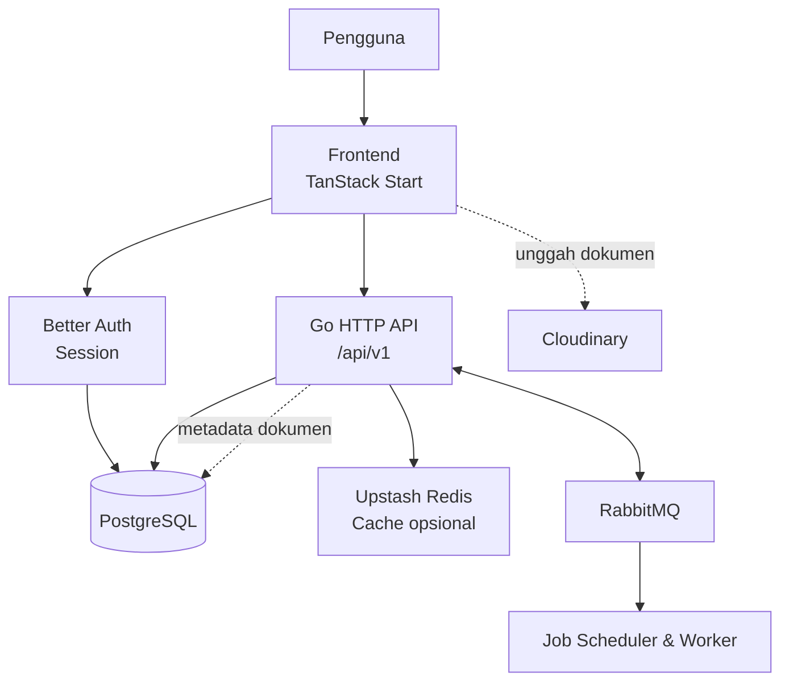

<!-- SIMPEG root documentation -->

<p align="center">
  <strong>SIMPEG</strong><br />
  <sub>Sistem Informasi Kepegawaian</sub>
</p>

<p align="center">
  Platform pengelolaan data dan proses kepegawaian yang terstruktur,
  terlacak, dan dapat diaudit.
</p>

<p align="center">
  <a href="https://github.com/adhitiad/sipeg/actions/workflows/backend.yml">
    
  </a>
  <a href="https://github.com/adhitiad/sipeg/actions/workflows/frontend.yml">
    
  </a>
  
  
  
  
</p>

<p align="center">
  <a href="#tentang">Tentang</a> ·
  <a href="#modul">Modul</a> ·
  <a href="#arsitektur">Arsitektur</a> ·
  <a href="#mulai-mengembangkan">Mulai</a> ·
  <a href="#dokumentasi">Dokumentasi</a>
</p>

---

> **Status: dalam pengembangan aktif — belum dinyatakan siap produksi.**
> Repository ini berisi fondasi aplikasi, API, modul bisnis, dan integrasi pendukung.
> Keberadaan kode atau halaman UI tidak otomatis berarti seluruh alur telah tervalidasi
> end-to-end. Gunakan [Checklist Staging & Produksi](docs/STAGING-RELEASE-CHECKLIST.md)
> sebagai gerbang rilis.

## Tentang

**SIMPEG (Sistem Informasi Kepegawaian)** adalah aplikasi web untuk membantu institusi
mengelola data, administrasi, dan siklus proses kepegawaian dalam satu sistem.
Fokus pengembangan saat ini adalah kebutuhan lingkungan perguruan tinggi, dengan
Universitas Subang sebagai konteks produk.

Prinsip arsitekturnya sederhana: frontend mengelola pengalaman pengguna, backend
menjadi otoritas aturan bisnis dan akses data, sementara database serta pekerjaan
latar dikelola melalui komponen yang terpisah.

## Ringkasan teknologi

| Area | Teknologi |
|---|---|
| Frontend | React, TanStack Start, TanStack Router |
| UI & data client | shadcn/ui, TanStack Query, Table, Store |
| Bahasa frontend | TypeScript |
| Runtime / package manager | Bun |
| Backend | Go, GORM |
| API | HTTP/JSON, OpenAPI 3.1 |
| Database | PostgreSQL |
| Migrasi database | Goose |
| Autentikasi | Better Auth |
| Background jobs | RabbitMQ |
| Cache opsional | Upstash Redis — cache data referensi non-sensitif |
| File dokumen | Cloudinary, sesuai konfigurasi |
| Container | Docker Compose / Podman Compose |

## Modul

Modul dan kemampuan berikut memiliki implementasi di repository pada tingkat yang
berbeda. Integrasi, aturan bisnis tertentu, dan validasi pada database target tetap
harus diperiksa melalui dokumentasi status dan checklist rilis.

| Area | Cakupan |
|---|---|
| **Data pegawai** | Direktori, detail, impor pegawai, kategori, dan metadata arsip dokumen |
| **Organisasi** | Unit kerja, homebase, struktur organisasi, dan master jabatan |
| **Presensi** | Ingestion event mesin dan pembacaan data presensi; pemetaan perangkat/vendor masih terbatas |
| **Penggajian** | Komponen gaji, honor, tunjangan/potongan, slip PDF, QR verifikasi, dan konfirmasi pembayaran |
| **Cuti** | Pengajuan, eviden, persetujuan, pembatalan, dan perhitungan saldo sesuai aturan yang dikonfigurasi |
| **Status kepegawaian** | Fondasi kontrak PKWT/PKWTT, pemberhentian, dan pensiun |
| **Akses & audit** | Role/permission, cakupan akses, delegasi, dan jejak audit |
| **Operasional** | Health/readiness, logging terstruktur, rate limit, metrik SLO, dan notifikasi antrean |

> PRD menggambarkan kebutuhan dan arah produk, bukan bukti bahwa semua kebutuhan
> sudah selesai. Lihat [Rencana Implementasi](docs/IMPLEMENTATION-PLAN.md) dan
> [Log Keputusan](docs/DECISIONS.md) untuk status, batasan, serta keputusan yang
> masih menunggu pemilik produk.

## Arsitektur



### Batas tanggung jawab

- **Frontend** menangani antarmuka dan sesi. Operasi bisnis dilakukan melalui Go API.
- **Go API** menjadi otoritas validasi, permission, dan cakupan akses.
- **PostgreSQL** menggunakan migrasi Goose sebagai sumber skema. `GORM AutoMigrate`
  tidak digunakan untuk deployment produksi.
- **Better Auth** berjalan pada runtime frontend di `/api/auth/*`. Sesi diteruskan
  ke API sebagai bearer token.
- **RabbitMQ** menangani pekerjaan terjadwal dan proses latar. QStash tidak digunakan.
- **Redis** hanya untuk cache referensi non-sensitif; bukan penyimpanan transaksi atau
  sumber kebenaran.

## Keamanan dan data

SIMPEG memproses informasi kepegawaian yang dapat memuat data pribadi. Keamanan
harus diterapkan pada konfigurasi, kode, dan proses operasional.

- **Otorisasi server-side:** permission dan cakupan data ditegakkan di backend
  dengan prinsip deny-by-default.
- **Enkripsi PII:** kolom identitas tertentu dienkripsi di level aplikasi
  menggunakan AES-256-GCM, dengan blind index HMAC-SHA256 untuk pencarian kesetaraan.
- **Sesi:** token sesi frontend disimpan di memori tab; keputusan akses tetap
  dilakukan oleh backend.
- **Audit:** aktivitas penting dicatat dalam jejak audit.
- **Secrets:** kredensial dan kunci enkripsi hanya berasal dari environment atau
  secret manager, bukan source code.
- **Data pengujian:** gunakan data sintetis. Jangan commit data pegawai nyata,
  token, password, atau dokumen sensitif.

Variabel produksi penting: `DATABASE_URL`, `BETTER_AUTH_SECRET`,
`PII_ENCRYPTION_KEY`, dan `TRUSTED_ORIGINS`. Simpan salinan aman
`PII_ENCRYPTION_KEY`; kehilangan kunci dapat membuat data PII terenkripsi tidak
dapat dibaca.

Rincian: [Threat Model](docs/THREAT-MODEL.md) ·
[Security Test](docs/SECURITY-TEST-OWASP-2025.md).

## Mulai mengembangkan

### Prasyarat

- Go **1.27.4** sesuai `backend/go.mod`
- Bun **1.4+**
- Node.js **20+** untuk worker pengujian frontend tertentu
- PostgreSQL yang dapat diakses backend dan runtime Better Auth
- Docker Compose v2 atau Podman Compose untuk broker dan stack backend

### 1. Clone repository dan siapkan konfigurasi

```bash
git clone https://github.com/adhitiad/sipeg.git
cd sipeg
cp .env.example .env
```

Isi konfigurasi database, secret autentikasi, kunci enkripsi PII, origin tepercaya,
dan kredensial RabbitMQ. Lihat komentar di `.env.example` untuk format dan aturan
tiap variabel.

**Gunakan database disposable untuk pengembangan.** Stack backend menjalankan
migrasi yang terdaftar di repository. Jangan arahkan perintah ini ke staging atau
produksi tanpa mengikuti prosedur persetujuan migrasi.

### 2. Jalankan RabbitMQ dan backend

Jalankan dari direktori root:

```bash
# Broker dijalankan terlebih dahulu
docker compose -f rabbitmq/docker-compose.yml up -d

# Migrasi, scheduler, dan API
docker compose up -d --build

# Periksa readiness API
curl http://localhost:8080/ready
```

Endpoint operasional:
- `GET /health` — liveness.
- `GET /ready` — readiness.
- `/api/v1/*` — endpoint data dan proses bisnis.

UI manajemen RabbitMQ untuk pengembangan tersedia di
`http://localhost:15672`. Kredensial default wajib diganti sebelum layanan
digunakan di luar komputer lokal; jangan mengekspos port manajemen ke internet.

### 3. Jalankan frontend

Buka terminal baru:

```bash
cd frontend
cp .env.example .env
bun install
bun --bun run dev
```

Frontend berjalan di `http://localhost:3000`. Untuk menggunakan proksi
development same-origin, atur di `frontend/.env`:

```dotenv
VITE_API_BASE_URL=/api/v1
VITE_API_PROXY_TARGET=http://localhost:8080
```

Runtime Better Auth memerlukan `DATABASE_URL` dan `BETTER_AUTH_SECRET`
server-side di `frontend/.env`. Salin nilainya dari konfigurasi lokal root.
Jangan menaruh secret pada variabel berawalan `VITE_`.

### 4. Backend native (opsional)

Untuk menjalankan backend tanpa container, siapkan environment dan database
terlebih dahulu. Backend tidak memuat file `.env` secara otomatis.

Jalankan dari `backend/`:

```bash
go mod download
go test ./...
go vet ./...
go build ./...
go run ./cmd/server
```

Pastikan variabel environment yang dibutuhkan tersedia pada proses tersebut.

## Perintah pemeriksaan

Jalankan backend dari `backend/`:

```bash
go test ./...
go test -race ./...
go vet ./...
go build ./...
go mod verify
```

Jalankan frontend dari `frontend/`:

```bash
bun --bun run format:check
bun --bun run lint
bun --bun run typecheck
bun run test
bun --bun run e2e
bun --bun run build
```

Sebagian tes E2E membutuhkan backend dan dataset disposable. Tes yang dilewati
karena dependensi belum tersedia tidak boleh dianggap lulus.

## Struktur repository

```text
.
├── backend/             # Go API, domain, repository, migrasi, dan worker
├── frontend/            # TanStack Start, UI, sesi, dan API client
├── docs/                # PRD, OpenAPI, keputusan, runbook, dan checklist
├── rabbitmq/            # Broker dan konfigurasi RabbitMQ
├── observability/       # Template monitoring, alerting, dan log
├── scripts/             # Helper operator dan backup/restore drill
├── agents/rules/        # Aturan kontribusi dan panduan agen
├── docker-compose.yml   # Migrasi, scheduler, dan backend
├── .env.example         # Template environment root
├── AGENTS.md            # Instruksi kerja repository
└── README.md
```

## Dokumentasi

| Dokumen | Kegunaan |
|---|---|
| [PRD](docs/PRD.md) | Kebutuhan, ruang lingkup, dan aturan produk |
| [OpenAPI](docs/openapi.yaml) | Kontrak endpoint HTTP/JSON |
| [Log Keputusan](docs/DECISIONS.md) | Keputusan produk/teknis dan statusnya |
| [Rencana Implementasi](docs/IMPLEMENTATION-PLAN.md) | Progres, bukti verifikasi, dan pekerjaan terbuka |
| [Runbook](docs/RUNBOOK.md) | Operasional dan penanganan insiden |
| [Threat Model](docs/THREAT-MODEL.md) | Aset, ancaman, dan kontrol keamanan |
| [Checklist Rilis](docs/STAGING-RELEASE-CHECKLIST.md) | Gerbang staging dan produksi |
| [Backup & Restore Drill](docs/backup-restore-drill.md) | Prosedur serta bukti uji pemulihan |
| [Performance Baseline](docs/PERFORMANCE-BASELINE.md) | Metode dan hasil pengukuran performa |
| [Dynamic Route Verification](docs/DYNAMIC-ROUTE-VERIFICATION.md) | Verifikasi rute, role, cakupan, dan IDOR |
| [Backend Guide](backend/README.md) | Runtime, arsitektur lapisan, dan endpoint |
| [Frontend Guide](frontend/README.md) | Konfigurasi, skrip, dan struktur UI |
| [RabbitMQ Guide](rabbitmq/README.md) | Topologi broker dan operasi antrean |
| [Observability Guide](observability/README.md) | Template monitoring dan alerting |

## Deployment dan kesiapan produksi

Deployment backend menggunakan dua Compose stack:

1. `rabbitmq/docker-compose.yml` menjalankan broker dan membuat jaringan
   `simpeg-broker`.
2. `docker-compose.yml` di root menjalankan migrasi Goose, scheduler, dan Go API.

Frontend dibangun dan dijalankan sebagai aplikasi terpisah. Template observabilitas
di `observability/` bersifat opsional; pemasangan, konfigurasi penerima alert,
dan uji alert tetap harus dibuktikan pada infrastruktur target.

Sebelum go-live, pastikan:

- Migrasi dijalankan pada staging lebih dahulu dan skema diverifikasi.
- Backup database serta dokumen tersimpan di lokasi terpisah dan restore telah diuji.
- Secret produksi berbeda dari development; kunci enkripsi disimpan aman.
- TLS, DNS, trusted origins, firewall, dan header keamanan telah diverifikasi.
- Smoke test, uji beban, pemeriksaan keamanan, dan rencana rollback selesai.
- Keputusan bisnis yang masih terbuka telah disetujui pemilik produk.

SIMPEG belum dinyatakan production-ready hanya berdasarkan build atau status CI.
Ikuti [Checklist Staging & Produksi](docs/STAGING-RELEASE-CHECKLIST.md) dan
[Runbook](docs/RUNBOOK.md) sebelum rilis. Tindakan prioritas dan status migrasi
terbaru dicatat pada [Rencana Implementasi](docs/IMPLEMENTATION-PLAN.md).

## Konvensi pengembangan

- Baca `AGENTS.md` dan panduan pada `agents/rules/` sebelum mengubah kode.
- Teks UI dan dokumentasi menggunakan Bahasa Indonesia; identifier kode menggunakan
  Bahasa Inggris.
- Migrasi Goose adalah sumber skema database; jangan gunakan `AutoMigrate` untuk produksi.
- Endpoint bisnis baru harus didokumentasikan di `docs/openapi.yaml`.
- Jangan commit secret, kredensial, data pribadi, atau file ekspor dari lingkungan nyata.
- Gunakan database disposable dan data sintetis untuk pengujian yang menyentuh data.

---

<p align="center">
  <strong>SIMPEG</strong> · Sistem Informasi Kepegawaian<br />
  <sub>Dibangun dengan fokus pada keamanan, keterlacakan, dan administrasi yang tertata.</sub>
</p>
